# NetMeter

[中文](#中文) · [English](#english)

NetMeter 是一个 Windows 本机代理流量悬浮方格，界面支持中文和英文双语。Electron 主进程在后台每秒采集代理控制器数据，按目标域名展示下载、上传速度和本机累计流量，不会主动发起测速。

NetMeter is a compact always-on-top traffic tile for Windows. The interface ships in Chinese and English. The Electron main process samples the proxy controller in the background once per second and shows per-domain download/upload speed and local totals. It never runs an active speed test.

## 截图 / Screenshots

悬浮方格 / Floating tiles

| 中文 | English |
|---|---|
| 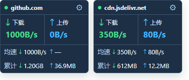 | 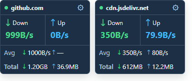 |

历史面板：「历史流量」与「历史均速」 / History panel: traffic and average speed

| 中文 | English |
|---|---|
| 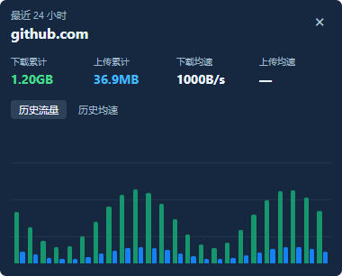 | 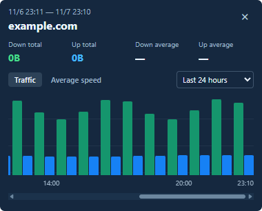 |
| 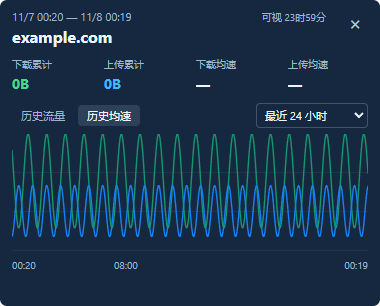 | 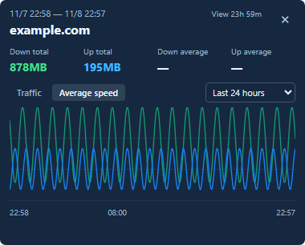 |

设置页 / Settings

| 中文 | English |
|---|---|
| 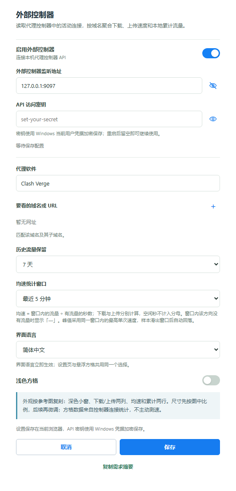 | 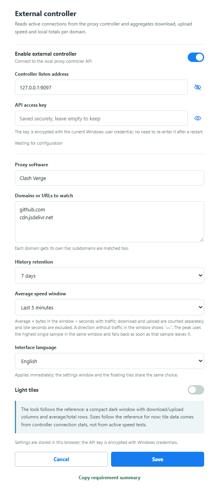 |

托盘图标：浅色 / 深色背景、多种尺寸预览 / Tray icon: light/dark backgrounds and size variants

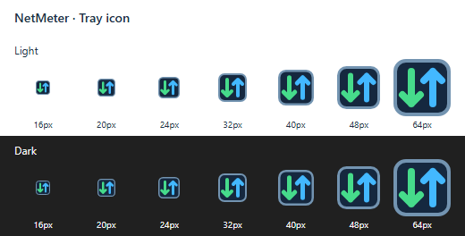

窗口标题栏实际截图 / Native window title bars

| 中文 | English |
|---|---|
| 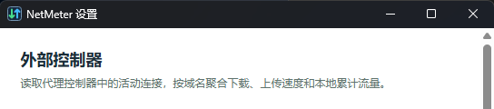 | 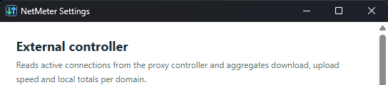 |

系统拒绝自动固定时的实际引导 / Native guide when automatic pinning is unavailable

| 中文 | English |
|---|---|
| 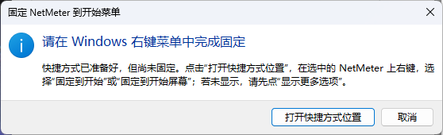 | 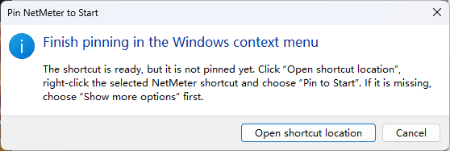 |

---

# 中文

## UI 设计规范

当前视觉基线、交互规则和后续 UI 修改要求统一记录在 [UI_DESIGN_SPEC.md](UI_DESIGN_SPEC.md)。项目级约束见 [AGENTS.md](AGENTS.md)，修改方格、设置页或历史页前应先阅读规范。

## 桌面版

需要 Node.js 24 或更新版本。首次在项目目录运行：

```powershell
npm install
npm start
```

启动后，每个已勾选的网址显示为独立的置顶方格窗口；设置窗默认隐藏，点击任意方格齿轮或托盘设置入口都会打开同一个全局设置窗口。方格窗口独立，网址列表、主题、界面语言、控制器配置和后台流量账本仍由同一个 NetMeter 应用共享；应用同时驻留在 Windows 托盘。

在任意方格上按住鼠标左键拖动可整体移动所有方格，保持彼此间距；按住 `Ctrl` 拖动则只移动指针下的方格（Ctrl 在按下鼠标前后按都有效，拖动中按下也能切换为单格拖动）。靠近其他方格时会按 X/Y 轴独立自动对齐；远离候选后会脱离吸附。单格拖动不会移动其他方格，可跨屏连续拖动；每格位置保存在本机。右键方格可打开全局设置、隐藏所有方格或退出，单击托盘图标可显示/隐藏整组方格。

Windows 托盘使用绿色下载、蓝色上传双箭头图标；`assets/tray/netmeter.ico` 含 16–64px 七档尺寸，避免原 SVG 被原生接口解码为空图。单击和右键菜单保持不变。

任务栏固定使用独立的 NetMeter Windows 身份、重启名称和 ICO，窗口与快捷方式保存相同 AppUserModelID；启动时修复旧快捷方式。**之前已经固定的通用 Electron 项需先取消固定，再从更新后的 NetMeter 重新固定**，应用不会改写用户的固定项布局。

设置窗口标题栏、悬浮方格窗口和托盘统一使用同一份双箭头 ICO；应用在创建窗口前先更新用户数据目录中的旧图标。开始菜单里的 `NetMeter` 快捷方式由 `scripts/install-start-menu.ps1` 生成，并复制同一份 ICO，不再绘制旧波形，缺失时应用启动会自动补齐。

**创建快捷方式不等于固定。** 托盘或方格右键菜单选择“固定到开始菜单…”后，应用会准备快捷方式并请求系统固定，只有确认系统已固定才显示成功。若 Windows 拒绝自动固定，会明确提示尚未固定：点击“打开快捷方式位置”，右键选中的 `NetMeter` → “固定到开始”或“固定到开始屏幕”（必要时先选“显示更多选项”）。取消不会打开资源管理器，启动不会自动固定。

方格的统计行默认显示均速；点击“均速”可切换为“峰值”，每个方格独立切换。均速与峰值共用设置页选定的统计窗口（最近 2 / 5 / 10 分钟，默认 5 分钟）：均速是窗口内该方向的字节增量 ÷ 该方向有流量的秒数，下载与上传各自独立、空闲秒不计入分母；峰值取窗口内该方向有流量的最高单次采样速度，样本滑出窗口后自动回落，窗口内无流量时两者都显示“—”。点击方格顶部的域名可查看该域名的历史流量，历史视图直接在方格窗口内展开，使用与方格一致的整窗实色背景，不使用内层弹窗或整窗纵向滚动。两个历史标签共用“最近 1/6/24 小时、7/30 天”时间范围选择，默认 24 小时并记住最近选择。图表保留真实起止日期和空闲区段；未保存缩放时，默认在窗口内完整显示所选总范围，放大后可用滚动条、普通滚轮、触摸板及 Home/End 查看。总范围不变时重开会遵从已保存的可视跨度，先显示最新部分；切换总范围时清空缩放记忆，恢复完整跨度。流量在 1/6 小时内按 5 分钟画柱，较长范围按小时；均速始终保留原始分钟分辨率，不设固定的初始像素密度。总范围与可视跨度分开：在图表上按住 Ctrl 滚轮向上放大、向下缩小，尽量保持光标下的时间不动；顶部实时显示当前可见起止时间与“可视”时长。仅对当前所选总范围分别记住两种图表的缩放，范围不变时关闭重开或重启仍保留；切换总范围清空两图记忆，切回旧范围也不恢复旧缩放。缩放不改变总范围、样本值或均速口径。纵轴和悬停读数仍是同一统计窗口内的均速，口径与方格一致。曲线上的悬停读数给出光标所在分钟的均速（该统计窗口内该方向的字节增量 ÷ 有流量的秒数），并带一条竖直指示线标出该分钟；历史曲线只用均速，不使用峰值代替。旧历史若有字节但缺少对应方向的活跃秒，该方向窗口均速无法还原，曲线留空并提示，流量柱状图仍保留原字节；不再擅自按 60 秒摊薄。此前已经被补写为 60 秒的少量旧记录无法与真实 60 秒数据可靠区分，不能自动恢复。

历史面板会记住上次选中的标签：下次打开任意域名的历史或重启应用后会恢复该视图。首次使用默认“历史流量”，无需在设置页另选默认值。

## 界面语言

设置页的「界面语言」提供「简体中文」和「English」两项，选择后立即生效，无需重启。设置窗口与悬浮方格共用同一个选择：切换语言后设置页立刻换文案，已打开的悬浮方格也会通过 `storage` 事件同步换成同一语言。语言记录在独立的 `netmeter-language` 本地存储键里，不会被设置保存覆盖。

下拉框的取值（如「最近 5 分钟」「7 天」）是本地存储用的稳定键，切换语言只改变显示文案，取值保持不变，因此两种语言下的历史数据和均速窗口完全一致。

托盘菜单、设置窗口标题和悬浮方格的右键菜单同样跟随界面语言。

## 控制器配置

- 地址填写代理控制器的本机 HTTP API 地址，默认 `127.0.0.1:9097`。
- 在 API 密钥框输入访问密钥；网址使用条目列表，点“+”新增、在输入框直接编辑、点“×”移除。每条左侧的复选框控制是否显示方格，保存后生效并记住选择；取消勾选仍保留条目和历史，继续采集，重新勾选即可恢复。旧网址自动迁移为已勾选条目。路径不参与匹配，子域名会归并到对应方格。监听地址和密钥右侧的眼睛按钮只在显示与隐藏之间切换，不写入剪贴板。
- 保存后由 Electron 主进程每秒读取一次控制器活动连接；渲染器只展示后台账本，不负责记账。窗口隐藏、最小化或被遮挡时采集仍继续，且请求不会因后台渲染节流而暂停。控制器在空闲时返回 `connections:null` 也算有效快照，仍会结算该次全局累计。控制器全局累计计数用于校验已结束连接的总流量；域名累计仍是活动连接观测下界，关闭前未被观察到的尾段无法可靠归属到域名，界面不会猜测分配。连接去重记录保留七天并定时回收，旧账本会自动迁移。
- 密钥不写入 `localStorage`、项目文件或日志，而是由 Electron `safeStorage` 使用 Windows 当前用户凭据加密保存。首次输入后，重启应用无需再次输入；密钥框留空会继续使用已保存值。禁用控制器不会删除已保存密钥，只有更换控制器地址时才需要重新输入。
- 历史流量由主进程 SQLite 账本按实际观测时间归入分钟桶，可选保留 7 天、30 天或长期；新样本同时记录下载与上传各自的有流量秒数，供历史均速曲线使用。旧版 IndexedDB 数据会幂等迁移；旧样本可能缺少活跃秒，无法精确计算均速。详情图表可选择最近 1/6/24 小时或 7/30 天，并横向滚动。
- 采集定时器、回环 HTTP 服务和 SQLite 连接都属于 NetMeter 主进程本身。应用不会安装外部 watcher、后台服务或开机自启项；从托盘选择“退出 NetMeter”会停止采样、关闭服务和数据库，测试探针也都有硬超时并自动退出。

默认控制器地址要求为本机回环地址，采集服务只绑定 `127.0.0.1`。若默认端口 `4174` 被占用，应用会尝试后续 9 个端口。

## 网页调试

也可单独运行同源转发服务检查设置页：

```powershell
node server.mjs
```

访问 `http://127.0.0.1:4174/`。此模式没有 Windows 托盘或独立置顶窗口。

## 开发校验

```powershell
npm test
```

`npm test` 覆盖均速与峰值口径、历史曲线、后台账本与采集器、拖动对齐、服务端密钥处理和双语字典一致性。离屏 Electron 探针位于 `scripts/`：`i18n-probe.cjs` 校验中英文渲染与语言切换，`background-collector-probe.cjs` 验证隐藏窗口采样、短连接、重复计数与正常退出，`window-ready-probe.cjs` 校验设置页失败恢复，`screenshot-probe.cjs` 生成 `docs/screenshots/` 下的效果图，`history-curve-probe.cjs` 校验历史曲线与标签栏，`domain-entries-probe.cjs` 校验网址条目的增删编辑、显示选择与重载记忆，并更新中英文设置页效果图。`generate-tray-icons.cjs` 从 SVG 重建多尺寸 ICO/PNG 和托盘预览；`tray-icon-probe.cjs` 校验像素、原生解码和 Windows 托盘注册。所有探针使用隔离数据、硬超时并自动退出，不显示测试窗口。

---

# English

## UI design spec

The current visual baseline, interaction rules and the requirements for later UI changes are recorded in [UI_DESIGN_SPEC.md](UI_DESIGN_SPEC.md). Project-level constraints live in [AGENTS.md](AGENTS.md); read the spec before changing the tiles, the settings page or the history panel.

## Desktop app

Requires Node.js 24 or newer. On a fresh checkout run:

```powershell
npm install
npm start
```

On startup, each checked domain appears in its own always-on-top tile window, and the settings window stays hidden. Clicking any tile's gear or the tray's settings command opens the same global settings window. The tile windows are independent, while the domain list, theme, language, controller configuration, and traffic ledger remain shared by the single NetMeter app in the Windows tray.

A plain left-button drag anywhere on a tile moves all visible tiles by the same desktop displacement. Holding `Ctrl` while dragging moves only the tile under the pointer; Ctrl works before or after mouse-down, and pressing it mid-drag switches to a single-tile drag. When a tile approaches an eligible neighbor, it actually snaps independently on X or Y; the entry threshold is 8 logical pixels and it detaches as you move away. Neighbors must overlap or touch on the perpendicular axis, and a single-tile drag never moves another tile. Free placement, overlap, and continuous cross-monitor movement are supported. Tile positions are saved locally. Right-click a tile to open the shared settings, hide all tiles, or quit; click the tray icon to show or hide the tile group.

The Windows tray uses green download and blue upload arrows. `assets/tray/netmeter.ico` includes seven sizes from 16 to 64px, replacing the SVG input that decoded as an empty native image. Click and context-menu behavior is unchanged.

Windows pins use the explicit NetMeter application identity, relaunch name, command, and ICO. Windows and shortcuts share the same AppUserModelID, and startup repairs older shortcuts. **Unpin any existing generic Electron item and pin the updated NetMeter again**; the app does not rewrite your existing pinned layout.

The settings title bar, widget window, and tray share the same transfer-arrow ICO. Startup updates the old icon in the user-data directory before creating any windows. `scripts/install-start-menu.ps1` creates the `NetMeter` Start menu shortcut using that same shipped icon instead of redrawing the obsolete waveform; startup recreates a missing shortcut.

**Creating a shortcut is not pinning it.** Choose “Pin to Start…” in the tray or tile context menu to prepare the shortcut and request native pinning. Success is reported only after Windows confirms it. If Windows rejects automatic pinning, the app explicitly says it is not pinned yet: choose “Open shortcut location”, right-click the selected `NetMeter` shortcut, then choose “Pin to Start” (use “Show more options” first if needed). Cancel does not open Explorer, and startup never automatically pins the app.

The statistics row of a tile shows the average by default; click “Avg” to switch it to “Peak”. Each tile switches on its own. The average and the peak share the statistics window chosen in the settings (last 2 / 5 / 10 minutes, 5 minutes by default): the average is the byte delta in that window ÷ the seconds in that direction that carried traffic, computed separately for download and upload with idle seconds excluded from the denominator; the peak is the highest single-sample speed of that direction inside the same window, and it falls back as soon as its sample leaves the window. Both show “—” when the direction had no traffic in the window. Click the domain at the top of a tile to open that domain's traffic history; the history view expands inside the tile window itself, using the same solid window background as the tiles, with no inner dialog or vertical window scrolling. Both history tabs share a remembered range selector: last 1/6/24 hours or 7/30 days (24 hours by default). The dated timeline preserves the actual bounds and idle gaps. Without a saved zoom, it initially displays the entire selected range; zoom in for finer detail and navigate with the scrollbar, mouse wheel, touchpad, or Home/End. Reopening history in the same total range keeps the saved visible span and starts at its newest portion. Changing the total range clears the saved zoom and displays the entire new range. Traffic uses five-minute bars for the 1/6-hour ranges and hourly bars for longer ranges. Average speed retains the original minute resolution at every zoom level, using the same statistics window and definition as the tiles. The total range and visible span are independent: Ctrl + wheel up zooms in and Ctrl + wheel down zooms out, keeping the time under the cursor anchored where possible. The header follows the visible start/end times and shows the visible duration. Each chart remembers its own zoom only for the currently selected total range, across reopening and restarts while that range is unchanged. Switching the total range clears both charts; returning to an earlier range does not restore its old zoom. No per-range zoom cache is kept. Zoom never changes the total range, sample values, or averaging definition. Hovering the curve reads out the average speed of the minute under the cursor (the byte delta in that statistics window ÷ the seconds that carried traffic) and marks the minute with a vertical guide line; the history curve only ever reports averages and never substitutes a peak. If older byte records lack active seconds for a direction, that direction’s window cannot have a truthful average: the curve has a gap and a bilingual notice, while the traffic bars retain their byte totals. We no longer spread such bytes over an invented 60 seconds. Some earlier records already written with a synthetic 60 seconds cannot reliably be distinguished from genuine 60-second records or reconstructed automatically.

The history panel remembers the last selected tab. Reopening another domain or restarting the app restores that view. On first use it starts with “Traffic”; there is no separate default-view setting.

## Interface language

The settings page offers “简体中文” and “English” under “Interface language”. The choice applies immediately, without a restart. The settings window and the floating tiles share the same choice: switching the language repaints the settings page right away, and an open widget follows it through the `storage` event. The language is stored under its own `netmeter-language` local storage key, so saving the settings never overwrites it.

The values behind the dropdowns (such as “最近 5 分钟” / “7 天”) are stable keys used for local storage. Switching the language changes only the visible text and keeps the values, so the history data and the statistics window are identical in both languages.

The tray menu, the settings window title and the tile right-click menu follow the interface language as well.

## Controller configuration

- The address is the local HTTP API address of your proxy controller; it defaults to `127.0.0.1:9097`.
- Enter the access key in the API key box. Websites are editable list entries: use “+” to add one, edit its input directly, or use “×” to remove it. The checkbox controls whether its tile is shown. Save to apply and remember the selection. Unchecked entries keep collecting traffic and retain their history; check them again to restore the tile. Existing websites migrate as checked entries. Paths do not participate in matching, and subdomains are folded into the matching tile. The eye buttons next to the listen address and the key only toggle between showing and hiding; they never write to the clipboard.
- After saving, the Electron main process samples active controller connections once per second; the renderer only displays the backend ledger. Hidden, minimized, or covered windows do not stop collection. An idle `connections:null` response is accepted as a valid snapshot, so its controller-wide cumulative totals are still settled. Controller-wide cumulative counters validate ended traffic, while per-domain totals remain an observed lower bound because a closing tail cannot be attributed reliably without a completion event; NetMeter does not guess that attribution. Connection deduplication records are retained for seven days and compacted periodically, with existing ledgers migrated automatically.
- The key is never written to `localStorage`, project files or logs. Electron's `safeStorage` encrypts it with the current Windows user credential. After the first entry the app restarts without asking again; leaving the key box empty keeps the saved value. Disabling the controller does not delete the saved key — only changing the controller address requires a new one.
- Traffic history is stored in the main-process SQLite ledger and bucketed by the actual observation minute; it can be kept for 7 days, 30 days or forever. Legacy IndexedDB samples are imported idempotently. New samples record download and upload active seconds independently for the average-speed curve; older samples may lack those seconds and cannot yield an exact average. The detail chart supports the last 1/6/24 hours or 7/30 days with horizontal scrolling.
- The sampling timer, loopback HTTP service and SQLite connection live inside the NetMeter main process. The app does not install an external watcher, background service or startup entry; choosing “Quit NetMeter” from the tray stops sampling and closes the service and database. Test probes have hard timeouts and exit automatically.

The default controller address must be a loopback address, and the collector only binds to `127.0.0.1`. If the default port `4174` is taken, the app tries the following 9 ports.

## Browser debugging

The same-origin forwarder can also run on its own to inspect the settings page:

```powershell
node server.mjs
```

Open `http://127.0.0.1:4174/`. This mode has no Windows tray and no separate always-on-top window.

## Development checks

```powershell
npm test
```

`npm test` covers the average and peak definitions, the history curve, the backend ledger and collector (including retries, ID reuse, cross-minute buckets and short connections), drag alignment, server-side secret handling and the consistency of the bilingual dictionary. The offscreen Electron probes live in `scripts/`: `i18n-probe.cjs` verifies Chinese and English rendering and the language switch; `background-collector-probe.cjs` covers hidden-window cadence, short connections, duplicate accounting and normal quit; `window-ready-probe.cjs` checks settings failure recovery; `screenshot-probe.cjs` produces images under `docs/screenshots/`; `history-curve-probe.cjs` verifies the history curve and tab bar; and `domain-entries-probe.cjs` checks website editing, visibility and reload persistence while updating the bilingual settings screenshots. `generate-tray-icons.cjs` rebuilds ICO/PNG sizes and the preview from the SVG source; `tray-icon-probe.cjs` checks pixels, native decoding and Windows tray registration. All probes use isolated data, have hard timeouts and exit automatically without displaying test windows.
